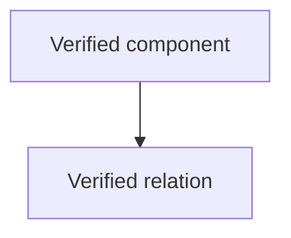

# System Diagrams

Create Mermaid diagrams from structure and contracts verified in the repository. Diagrams compress relations and flows to cut context load, helping AI and readers scan structure faster. Pick the right diagram type for the scope; never use diagrams to cover unsurveyed parts.

## Diagram types

- **Directory structure**: shows high-level directories, modules, entry points and main responsibilities.
- **Database ERD**: shows entities/collections, PK/FK or keys, cardinality, relevant indexes and verified relations.
- **User/system flow**: shows actor, entry point, validation/auth, service/module, database/external service, output and side effects.

## Process

1. Read relevant source files: manifest, routes, modules, schema/models, queries, API contracts and existing docs.
2. Determine the diagram scope and record the basis by path/file/line when possible.
3. Separate **Verified**, **Assumption** and **Insufficient data**; never invent fields, relations, actors or services.
4. Draw Mermaid with short labels, clear direction and only the components needed to understand the relation.
5. If the scope has no database or user/system flow, write `Not applicable`. If schema is missing, write `Insufficient data to draw ERD`.
6. Check the diagram against source files before handoff; fix wrong nodes/edges or drop parts lacking evidence.

## When diagrams reduce load

- Prefer diagrams with 3 or more related components, many sequential steps, hierarchy or cross-module dependencies hard to follow in prose.
- Do not draw every detail; keep enough nodes/edges to answer the doc's question.
- Use prose for purpose, assumptions, constraints, caveats and conclusions; never copy the whole diagram into a long list.

## Output template

```markdown
### Diagram [directory structure / ERD / user flow]

**Source**: `[file or scope read]`
**Status**: Verified / Has assumptions / Insufficient data


```

## Limits

- Never design new HLD/LLD; for architecture options, hand off to `architect`.
- Never run migrations, change schema/index or access the production database to draw diagrams.
- Never conclude ownership, cardinality, permissions or flow from file names alone.
